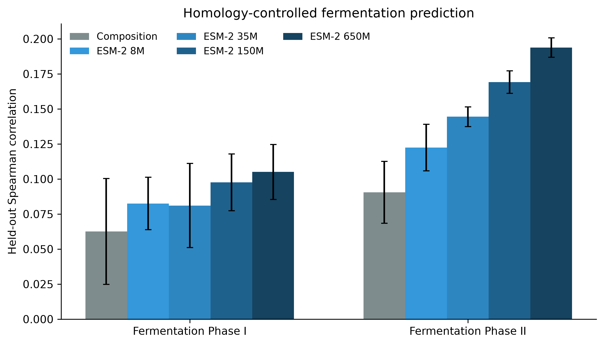
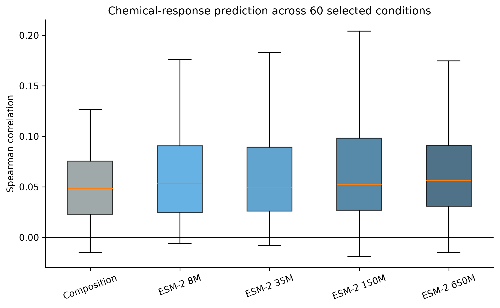
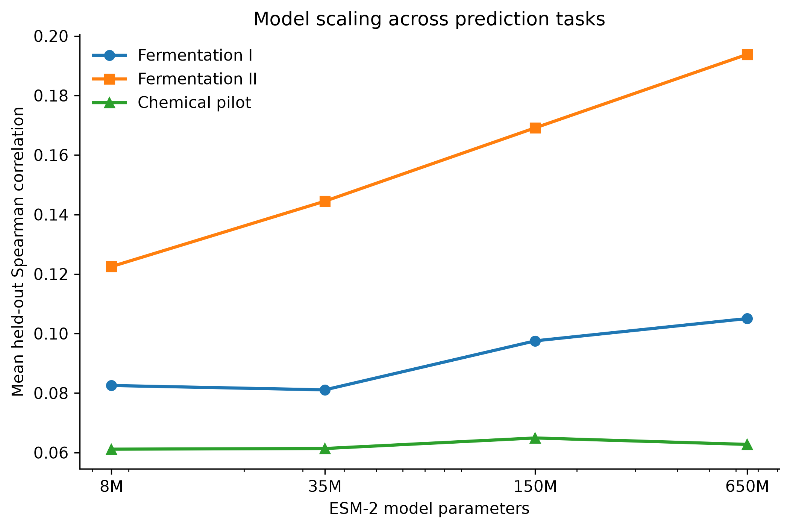
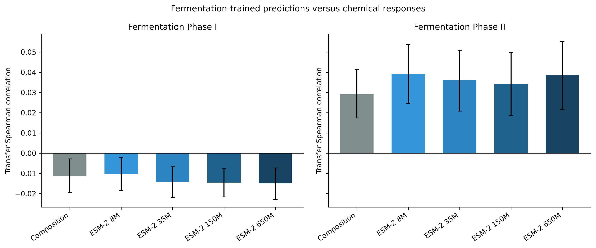

# When Do Pretrained Protein Models Improve Yeast Gene-Deletion Fitness Prediction? A Cross-Study Evaluation Across Fermentation and Chemical Perturbations

**Faizan Khan**

*Research manuscript — Version 1.0, October 2026*

**Keywords:** Protein language models; ESM-2; Saccharomyces cerevisiae; gene-deletion fitness; chemical genomics; transfer learning; homology-aware evaluation; model scaling.

---

## Abstract

**Background:** Pretrained protein language models provide sequence-derived representations that can support downstream biological prediction tasks. However, their utility for predicting organism-level phenotypes, particularly under experimental perturbations, remains incompletely characterized. It is also unclear whether increasing model size consistently improves prediction or whether associations learned in one experimental setting generalize to another.

**Methods:** We evaluated four pretrained ESM-2 protein language models containing approximately 8 million, 35 million, 150 million, and 650 million parameters against a sequence-composition baseline. Frozen protein embeddings were extracted for 4,491 *Saccharomyces cerevisiae* genes and evaluated using ridge regression. Fermentation fitness measurements were obtained from GEO accession GSE46145, representing two proliferative phases of wine fermentation. Chemical-response measurements were derived from the Hoepfner chemical-genomics dataset. We used homology-grouped gene splits and nested regularization selection. Chemical-response prediction was evaluated in a deterministic pilot of 60 selected conditions. Cross-study transfer was assessed by correlating held-out fermentation predictions with observed chemical responses.

**Results:** Under homology-grouped evaluation, the sequence-composition baseline achieved mean Spearman correlations of 0.0626 and 0.0906 for fermentation Phases I and II, respectively. The 650M-parameter ESM-2 model improved these values to 0.1050 and 0.1938. In the chemical-response pilot, sequence composition achieved a mean correlation of 0.0480, compared with 0.0611–0.0649 for ESM-2 models. The 150M model performed best numerically, with an improvement of 0.0169 over composition (95% condition-bootstrap confidence interval: 0.0086–0.0256). Its advantage over the 650M model was inconclusive. Cross-study transfer was weak: Phase II fermentation predictions exhibited correlations of 0.0294–0.0393 with chemical responses, whereas Phase I correlations ranged from −0.0150 to −0.0103.

**Conclusions:** Frozen pretrained protein representations provide modest predictive benefits over simple sequence composition, particularly for the Phase II fermentation endpoint. However, these gains are task-dependent, do not increase monotonically with model size, and do not translate into strong cross-study associations. These findings support evaluating protein language models against simple baselines across multiple biological conditions rather than assuming that larger pretrained models necessarily provide more transferable representations.

## 1. Introduction

Understanding how gene disruption affects cellular fitness is a central problem in functional genomics. In *Saccharomyces cerevisiae*, genome-wide deletion collections enable systematic measurements of gene contributions to growth and survival under different environmental conditions.

The effect of a gene deletion is not determined solely by the sequence of its encoded protein. Cellular phenotype also depends on metabolic state, pathway redundancy, environmental stress, compensatory mechanisms, and interactions with other genes.

Nevertheless, protein sequences contain evolutionary and biochemical information that may be informative about gene function. Recent protein language models learn numerical representations of amino acid sequences through large-scale self-supervised pretraining.

The ESM-2 family provides pretrained models at several parameter scales, enabling investigation of how representation size influences downstream performance [1].

Although protein language models have demonstrated capabilities in protein-level tasks, predicting gene-deletion fitness is a substantially different problem. The input represents an encoded protein, while the output measures an organism-level response to the absence of that gene.

This distinction motivates three questions:

1. Do pretrained protein embeddings improve yeast gene-deletion fitness prediction relative to simple sequence-composition features?
2. Does increasing protein language model size consistently improve performance across biological perturbations?
3. Do representations that predict fermentation fitness also provide useful associations with chemical-response phenotypes?

We investigate these questions using two independent experimental resources: fermentation-stage gene-deletion measurements and chemical-genomics perturbation profiles.

Our contribution is a comparative evaluation of frozen protein representations across multiple biological contexts, with emphasis on homology-controlled testing, model scaling, uncertainty in performance comparisons, and cross-study transfer limitations.

## 2. Related Work

### 2.1 Protein language models

Protein language models are trained on large collections of amino acid sequences to learn statistical regularities associated with evolutionary constraints and protein function.

Lin et al. introduced evolutionary-scale protein modeling and demonstrated the utility of language-model representations for protein structure prediction [1].

The ESM-2 family includes models at multiple parameter scales. This permits investigation of whether representational improvements observed in protein-level applications extend to downstream cellular phenotypes.

However, success in protein structure or sequence modeling does not automatically imply accurate prediction of organism-level fitness.

### 2.2 Gene-deletion fitness profiling

Pooled yeast deletion screens measure the relative behavior of strains carrying different gene disruptions.

Novo et al. investigated yeast adaptation during the proliferative stages of wine fermentation, using genome-wide barcoded deletion collections and quantitative fitness analysis [2].

Their experimental design included conditions approximating two fermentation phases, providing an opportunity to compare the predictability of related but biologically distinct environments.

### 2.3 Chemical-genomics profiling

Chemical-genomics screens measure the response of gene-deletion strains to chemical perturbations.

Such datasets provide a broad range of experimental conditions and enable assessment of whether models trained on sequence-derived representations capture information useful beyond a single growth environment.

However, chemical-response measurements may differ substantially from fermentation fitness measurements in experimental design, preprocessing, and biological interpretation.

Accordingly, cross-study comparisons require caution.

### 2.4 Generalization and evaluation

Randomly partitioning proteins into training and testing sets may permit closely related sequences to appear in both partitions.

This can overestimate generalization to more distinct proteins.

Homology-aware splitting offers a stricter evaluation by grouping related sequences before partitioning.

In addition, model comparisons should distinguish improvements within a dataset from transfer to independent experimental conditions.

The present study evaluates both dimensions.

## 3. Materials and Methods

### 3.1 Study design

We compared five sequence-based feature representations:

| Representation | Description |
|---|---|
| Sequence Composition | Simple amino acid sequence-composition features |
| ESM-2 8M | Frozen pretrained protein embedding |
| ESM-2 35M | Frozen pretrained protein embedding |
| ESM-2 150M | Frozen pretrained protein embedding |
| ESM-2 650M | Frozen pretrained protein embedding |

The analysis included three evaluation settings:

- Fermentation fitness prediction under homology-grouped gene splits.
- Chemical-response prediction across 60 selected experimental conditions.
- Cross-study associations between fermentation predictions and chemical-response measurements.

The primary evaluation metric was Spearman rank correlation between predictions and observed outcomes.

### 3.2 Fermentation dataset

Fermentation measurements were derived from the publicly available GEO dataset GSE46145 [2].

The original study investigated yeast adaptation to conditions resembling two proliferative stages of wine fermentation.

We analyzed processed homozygous deletion-pool measurements for:

- HOP Phase I
- HOP Phase II

The analysis used gene-level mean measurements derived from available experimental replicates.

The aligned dataset contained 4,491 genes with usable protein sequences, pretrained embeddings, and both fermentation targets.

The two phase measurements were treated as distinct prediction endpoints.

### 3.3 Chemical-response dataset

Chemical-response measurements were obtained from the Hoepfner chemical-genomics dataset distributed through Dryad, DOI 10.5061/dryad.v5m8v [3].

The source matrix contained 6,681 gene identifiers and 5,846 measurement columns.

Of these, 5,808 columns were identified as adjusted HOP measurements. Additional MADL and MADL z-score columns were excluded from the primary pilot.

After alignment with the sequence-feature dataset, approximately 23.83 million finite adjusted-HOP measurements were available, representing approximately 90.77% completeness.

Because exhaustive modeling of every chemical-response column was outside the scope of this initial analysis, we selected 60 conditions using a deterministic, evenly spaced procedure.

These conditions constitute a computational pilot rather than a statistically representative random sample of all chemical perturbations.

Furthermore, multiple measurement columns may correspond to the same experiment identifier. Consequently, conditions cannot automatically be treated as independent compounds or independent biological experiments.

### 3.4 Protein sequence representations

Protein sequences were associated with yeast gene identifiers.

For each gene, pretrained ESM-2 models generated frozen sequence embeddings.

The four models contained approximately 8M, 35M, 150M, and 650M parameters.

Protein representations were obtained by mean pooling residue-level embeddings.

For computational feasibility, input sequences were restricted to their first 1,022 amino acid residues.

This truncation strategy may omit functionally relevant regions of longer proteins.

The same gene-level representation was reused across downstream conditions, avoiding repeated protein-model inference.

The sequence-composition baseline used directly calculated sequence features rather than pretrained representations.

All downstream predictive models were trained independently from the frozen features.

### 3.5 Homology-grouped evaluation

Protein sequences were clustered using MMseqs2 with approximately 30% sequence identity and 80% shorter-sequence coverage criteria.

The resulting grouping contained 3,611 clusters, including 3,066 singleton clusters.

The largest cluster contained 15 genes.

Cluster assignments were used to construct five grouped gene partitions.

The intent was to reduce the likelihood that closely related sequences would be distributed across training and testing sets.

These criteria do not guarantee removal of every distant evolutionary relationship.

### 3.6 Predictive modeling

Ridge regression was used for all sequence-feature representations.

For a feature matrix \(X\), target vector \(y\), and regularization parameter \(\alpha\), ridge regression minimizes:

\[
\mathcal{L}(\beta)
=
\|y-X\beta\|_2^2
+
\alpha\|\beta\|_2^2.
\]

Regularization strengths were selected from:

\[
\alpha \in \{0.1,1,10,100,1000\}.
\]

Hyperparameter selection used grouped cross-validation within the training data.

Held-out genes were not intended to participate in model selection.

The same evaluation structure was applied to the sequence-composition and ESM-2 representations.

### 3.7 Evaluation metrics

The primary performance measure was Spearman rank correlation:

\[
\rho_s
=
\operatorname{corr}
\left(
\operatorname{rank}(y),
\operatorname{rank}(\hat{y})
\right).
\]

This measures the extent to which predicted gene rankings agree with observed phenotype rankings.

For fermentation prediction, we additionally examined coefficient of determination and mean absolute error.

Model comparisons focused primarily on Spearman correlation because ranking quality was the main outcome of interest.

### 3.8 Chemical-response comparisons

Each selected chemical-response condition was evaluated using the five feature representations and five homology-grouped gene splits.

This produced up to 300 condition–split evaluations per model.

Because the same conditions were evaluated repeatedly, these 300 evaluations were not treated as independent biological experiments.

For model comparisons, performance differences were first averaged across splits within each condition.

Bootstrap confidence intervals were then calculated by resampling the 60 condition-level differences with replacement for 5,000 iterations.

The random seed was 2026.

These intervals describe uncertainty under resampling of the selected pilot conditions. They do not account fully for dependencies among conditions sharing experimental identifiers.

### 3.9 Cross-study transfer assessment

To assess cross-study transfer, we reused out-of-sample predictions produced by fermentation-trained models.

For each fermentation phase, model, held-out gene split, and selected chemical-response condition, predicted fermentation values were aligned with observed chemical-response measurements by gene identifier.

We then calculated Spearman correlation between fermentation predictions and chemical-response observations.

No model was fitted to chemical-response outcomes during this transfer assessment.

This analysis tests whether the ordering induced by fermentation-trained models is associated with chemical-response measurements.

It does **not** demonstrate that a fermentation-trained model can predict calibrated chemical fitness values.

Results were summarized across the selected conditions and grouped evaluation splits.

Condition-level bootstrap intervals were calculated using 5,000 resamples.

## 4. Results

### 4.1 Homology-controlled fermentation prediction

Across the five homology-grouped splits, ESM-2 embeddings improved mean rank-correlation performance relative to sequence composition.

**Table 1. Mean Spearman correlation for fermentation prediction**

| Model | Phase I | Phase II |
|---|---:|---:|
| Sequence Composition | 0.0626 | 0.0906 |
| ESM-2 8M | 0.0825 | 0.1225 |
| ESM-2 35M | 0.0811 | 0.1445 |
| ESM-2 150M | 0.0975 | 0.1691 |
| ESM-2 650M | **0.1050** | **0.1938** |

The 650M model achieved the highest mean Spearman correlation for both fermentation endpoints.

Relative to sequence composition, its improvement was 0.0424 in Phase I and 0.1032 in Phase II.

However, absolute performance remained limited.

For Phase II, the best reported mean coefficient of determination was approximately 0.0365. For Phase I, it was approximately 0.0121.

These values indicate that most gene-level phenotype variation remained unexplained.

**Figure 1. Homology-controlled fermentation prediction**

*Bars represent mean held-out Spearman correlations; error bars represent standard deviations across evaluation splits.*

### 4.2 Chemical-response prediction

In the 60-condition chemical-response pilot, all ESM-2 models achieved higher mean Spearman correlations than sequence composition.

**Table 2. Mean chemical-response prediction performance**

| Model | Mean Spearman |
|---|---:|
| Sequence Composition | 0.0480 |
| ESM-2 8M | 0.0611 |
| ESM-2 35M | 0.0614 |
| ESM-2 150M | **0.0649** |
| ESM-2 650M | 0.0627 |

The 150M model achieved the highest mean correlation.

However, the overall correlations were small, indicating weak gene-level ranking performance.

**Figure 2. Chemical-response prediction**

*Boxplots summarize condition-level mean Spearman correlations across the selected chemical-response conditions.*

### 4.3 Paired model comparisons

We compared each ESM-2 model with sequence composition using paired condition-level differences.

**Table 3. Chemical-response improvements over sequence composition**

| Comparison | Mean Δ Spearman | 95% bootstrap CI |
|---|---:|---|
| 8M − Composition | +0.0131 | [0.0065, 0.0199] |
| 35M − Composition | +0.0133 | [0.0064, 0.0204] |
| 150M − Composition | +0.0169 | [0.0086, 0.0256] |
| 650M − Composition | +0.0147 | [0.0055, 0.0244] |
| 150M − 650M | +0.0022 | [−0.0033, 0.0078] |

All four ESM-2 comparisons with composition produced positive bootstrap intervals in this pilot.

However, the comparison between 150M and 650M crossed zero, providing insufficient evidence that either model was superior under the chosen resampling procedure.

These comparisons were exploratory and were not adjusted for multiple testing.

### 4.4 Model scaling

The relationship between ESM-2 model size and prediction quality differed across tasks.

For fermentation, performance generally improved as model size increased.

For chemical-response prediction, the 150M model numerically outperformed the 650M model.

This indicates that parameter count alone did not determine predictive performance across the evaluated endpoints.

**Figure 3. Model scaling**

*Mean Spearman correlation plotted against ESM-2 parameter count for the two fermentation endpoints and chemical-response pilot.*

### 4.5 Cross-study transfer

We next evaluated whether fermentation-trained predictions were associated with observed chemical-response phenotypes.

**Table 4. Mean cross-study Spearman correlations**

| Model | Phase I → Chemical | Phase II → Chemical |
|---|---:|---:|
| Sequence Composition | −0.0114 | +0.0294 |
| ESM-2 8M | **−0.0103** | **+0.0393** |
| ESM-2 35M | −0.0141 | +0.0361 |
| ESM-2 150M | −0.0146 | +0.0343 |
| ESM-2 650M | −0.0150 | +0.0386 |

Phase II predictions showed small positive associations with chemical responses.

Phase I predictions showed small negative associations.

Notably, the 8M ESM-2 model achieved the highest mean Phase II transfer correlation, despite the 650M model performing best on within-study fermentation prediction.

**Figure 4. Cross-study transfer**

*Mean transfer correlations and 95% condition-level bootstrap intervals across 60 selected chemical-response conditions.*

### 4.6 Uncertainty in transfer estimates

For Phase II, the estimated mean transfer correlations and confidence intervals were:

| Model | Mean | 95% CI |
|---|---:|---|
| Composition | 0.0294 | [0.0174, 0.0415] |
| ESM-2 8M | 0.0393 | [0.0245, 0.0538] |
| ESM-2 35M | 0.0361 | [0.0208, 0.0509] |
| ESM-2 150M | 0.0343 | [0.0187, 0.0497] |
| ESM-2 650M | 0.0386 | [0.0216, 0.0551] |

Although these intervals were positive, the observed effect sizes remained small.

Furthermore, the reported intervals concern each model's association with chemical responses, not paired differences between models.

Therefore, these results do not establish statistically reliable superiority of one representation over another in cross-study transfer.

## 5. Discussion

### 5.1 Pretrained representations offer modest biological information

The results indicate that frozen ESM-2 embeddings contain information useful for predicting yeast gene-deletion fitness beyond the information captured by simple sequence composition.

This improvement was most apparent for Phase II fermentation.

Nevertheless, even the best-performing model explained only a small fraction of phenotype variation.

One possible explanation is that protein sequences encode aspects of molecular function but cannot fully describe the cellular consequences of deleting a gene.

Such consequences may depend on expression levels, pathway context, regulatory networks, environmental state, and genetic redundancy.

These mechanisms were not directly tested in the present study.

### 5.2 Predictive benefits are condition-dependent

The difference between Phase I and Phase II fermentation prediction suggests that the relationship between protein sequence and deletion fitness depends on the experimental environment.

The larger improvement in Phase II may reflect differences in biological constraints, target variability, or measurement reliability.

However, the current experiments cannot determine which mechanism explains this difference.

### 5.3 Larger models are not always better

The fermentation experiments favored the largest evaluated ESM-2 model.

The chemical-response pilot instead favored the 150M model numerically.

For cross-study transfer, the 8M model achieved the highest mean Phase II association.

Together, these results suggest that larger protein language models do not necessarily yield better representations for every downstream cellular phenotype.

Importantly, differences between the leading models were small in the chemical-response pilot, and the available comparisons do not establish a universally optimal model size.

### 5.4 Within-study accuracy does not guarantee transfer

A central finding is the divergence between within-study performance and cross-study transfer.

The 650M model performed best for fermentation prediction, yet the smallest model achieved the highest mean Phase II transfer association.

More importantly, all cross-study correlations were weak.

This suggests that improving prediction of one experimental phenotype does not necessarily produce a representation that generalizes strongly to other perturbations.

The negative Phase I associations further emphasize the importance of evaluating transfer separately for different source endpoints.

These findings should be interpreted as cross-study association results rather than direct measurements of chemical-response prediction accuracy after model adaptation.

### 5.5 Implications for computational functional genomics

The results support three practical considerations.

First, simple sequence-based baselines remain necessary when evaluating pretrained protein representations.

Second, protein language model size should be treated as an empirical design choice rather than an assumed indicator of downstream superiority.

Third, evaluation across independent biological conditions can reveal limitations that are not apparent from within-study validation.

These considerations are relevant to research workflows that use pretrained representations as general-purpose features for functional genomics.

## 6. Limitations

Several limitations affect interpretation.

**Limited phenotype predictability.** Absolute Spearman correlations were generally small, and fermentation R² values remained close to zero.

**Sequence-only features.** The models did not incorporate gene expression, interaction networks, protein abundance, pathway annotations, or other condition-specific information.

**Protein truncation.** Sequences longer than 1,022 amino acids were truncated, potentially excluding relevant information.

**Incomplete homology exclusion.** Sequence clustering reduced related-sequence overlap but did not guarantee independence from all distant homologs.

**Chemical-condition sampling.** Only 60 deterministically selected conditions were evaluated from a much larger matrix.

**Condition dependence.** Some chemical-response columns may share experiment identifiers, reducing the effective number of independent experimental conditions.

**Endpoint differences.** Fermentation and chemical-response measurements originated from distinct experimental protocols and may differ in normalization and biological meaning.

**Transfer interpretation.** Cross-study evaluation correlated fermentation predictions with chemical observations. It did not establish calibrated chemical fitness prediction or adaptation to an unseen chemical dataset.

**Bootstrap assumptions.** Condition-level resampling did not fully account for shared experiment identifiers or dependencies among selected conditions.

**Numerical stability.** Ridge-regression fitting generated numerical conditioning warnings during the chemical pilot. Although results were produced, numerical sensitivity requires additional verification.

**Uncertainty and multiple comparisons.** The chemical-pilot confidence intervals were exploratory and not adjusted for multiple model comparisons.

**Novelty verification.** A comprehensive systematic review of all prior studies using protein language models for yeast deletion-fitness prediction has not yet been completed. Therefore, claims of being the first such evaluation are not warranted.

## 7. Conclusion

We evaluated four pretrained ESM-2 protein language models against a sequence-composition baseline for predicting yeast gene-deletion fitness across fermentation and chemical perturbations.

Pretrained embeddings consistently improved mean rank-correlation performance over sequence composition in the evaluated within-study settings.

The strongest improvement occurred for Phase II fermentation, where the 650M model achieved a mean Spearman correlation of 0.1938 compared with 0.0906 for composition.

Chemical-response improvements were smaller, and model scaling was not monotonic.

Cross-study transfer associations were weak, with small positive correlations for Phase II and slightly negative correlations for Phase I.

Overall, these findings suggest that pretrained protein representations offer useful but limited information for organism-level phenotype prediction.

Future work should examine larger and more independent perturbation panels, condition-aware features, stronger numerical validation, and additional model families to determine when protein sequence pretraining provides robust biological generalization.

## 8. Data and Code Availability

The analysis uses publicly available yeast functional-genomics datasets.

Fermentation data: NCBI GEO accession GSE46145.

Chemical-genomics data: Dryad DOI 10.5061/dryad.v5m8v.

Protein representations: pretrained ESM-2 models.

Experiment outputs, predictions, configurations, and figure-generation scripts are retained in the local research project.

**Public code repository:** [To be added after release]

**Archived code DOI:** [To be added if deposited]

## 9. Reproducibility Statement

The project preserves model embeddings, experimental result tables, predictions, and figure-generation scripts.

Five homology-grouped evaluation splits were used.

The chemical-response pilot included 60 selected conditions.

Condition-level bootstrap analysis used 5,000 resamples with seed 2026.

The generated figures are available in both PNG and PDF formats.

Complete end-to-end reproducibility, including software-version verification, dataset checksums, and clean-environment execution, remains to be independently confirmed before publication.

## 10. Declarations

**Funding:** [Author to confirm]

**Competing interests:** [Author to confirm]

**Ethics approval:** The study analyzes previously published yeast experimental datasets and does not involve new human or animal experimentation.

**Author contributions:** [To be completed and verified]

**Acknowledgments:** [To be completed]

## References

[1] Lin Z, Akin H, Rao R, et al. Evolutionary-scale prediction of atomic-level protein structure with a language model. *Science*. 2023;379(6637):1123–1130. https://doi.org/10.1126/science.ade2574

[2] Novo M, Mangado A, Quirós M, et al. Genome-wide study of the adaptation of *Saccharomyces cerevisiae* to the proliferative stages of wine fermentation. NCBI Gene Expression Omnibus, GSE46145. 2013. https://www.ncbi.nlm.nih.gov/geo/query/acc.cgi?acc=GSE46145

[3] Hoepfner D, et al. Chemical-genomics dataset associated with Dryad DOI 10.5061/dryad.v5m8v. https://doi.org/10.5061/dryad.v5m8v **[Full bibliographic citation and exact score definitions require verification.]**

[4] Meta Fundamental AI Research. Evolutionary Scale Modeling: pretrained protein language models and ESM-2 implementations. https://github.com/facebookresearch/esm

[5] Zhang Z, Wayment-Steele HK, Brixi GK, et al. Protein language models learn evolutionary statistics of interacting sequence motifs. *Proceedings of the National Academy of Sciences*. 2024;121(45):e2406285121. https://doi.org/10.1073/pnas.2406285121

---

### Manuscript preparation notes — remove before submission

- Verify the exact protein sequence source, version, and sequence-composition feature definition against the project scripts.
- Confirm the source dataset's chemical-score semantics, preprocessing, and full citation.
- Audit the cross-study transfer gene alignment and possible condition dependencies.
- Resolve ridge-regression numerical conditioning warnings.
- Verify model comparisons with appropriate paired uncertainty estimates.
- Add complete software versions, repository details, author declarations, and any journal-required statements.
- Expand the literature review and verify novelty before selecting a journal.
